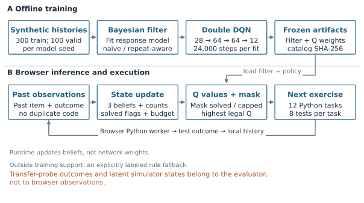
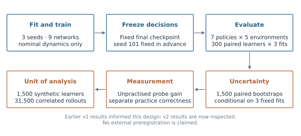
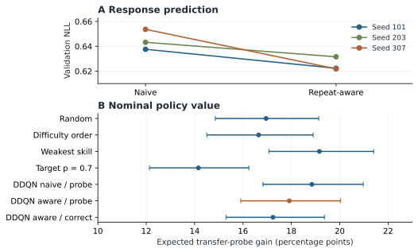
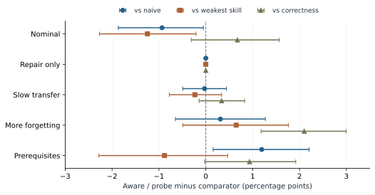

# Phân biệt thành công khi làm lại bài và năng lực vận dụng trong luyện tập lập trình thích nghi

Nghiên cứu mô hình người học, học tăng cường và hệ thống có thể kiểm chứng

## Tóm tắt

Hệ thống gợi ý bài lập trình cần phân biệt ba đại lượng: kết quả chấm chương trình, xác suất dự báo làm đúng và giá trị của việc chọn bài tiếp theo. Nghiên cứu xây dựng nguyên mẫu gồm 12 bài Python có thể chạy, bộ lọc Bayes ước lượng trạng thái người học và chính sách Double DQN. Thực nghiệm so sánh bảy chính sách trong năm môi trường mô phỏng, với ba seed huấn luyện và 31,500 lượt triển khai trên 1,500 người học mô phỏng phân biệt. Mô hình có xét độ quen bài giảm tổn thất dự báo trên cả ba tập validation. Tuy nhiên, chính sách tương ứng chỉ đạt 17.91 điểm phần trăm tăng trưởng phép đo vận dụng trong môi trường danh định, so với 18.85 của mô hình không xét độ quen bài và 19.16 của quy tắc chọn kỹ năng yếu nhất. Chênh lệch với quy tắc này là -1.24 điểm, khoảng tin cậy 95% có điều kiện [-2.27, -0.21]. Môi trường chỉ tăng độ quen bài cho mức tăng vận dụng bằng không dù vẫn có nhiều câu trả lời đúng. Đóng góp là hệ thống tái lập được và kết quả chỉ ra giới hạn của việc dùng chất lượng dự báo thay cho chất lượng gợi ý. Đây là bằng chứng mô phỏng; nghiên cứu chưa đo hiệu quả học tập trên sinh viên thật.

Từ khóa: học thích nghi; giáo dục lập trình; theo dõi tri thức; học tăng cường; mô phỏng; tái lập

## 1. Đặt vấn đề

Một sinh viên có thể sửa bài Fibonacci nhiều lần cho đến khi chương trình vượt qua mọi ca kiểm thử. Điều này xác nhận lời giải hiện tại phù hợp với bộ kiểm thử, nhưng chưa cho biết sinh viên có giải được một bài mới cần cùng ý tưởng hay không. Khi xây dựng hệ thống chọn bài tiếp theo, việc đánh đồng “làm đúng bài vừa sửa” với “học được kỹ năng có thể vận dụng” có thể dẫn đến lựa chọn mục tiêu tối ưu không phù hợp.

Đề tài số 4 yêu cầu kết nối mô hình trạng thái người học với chính sách chọn bài học được và một ứng dụng có thể vận hành. Thành phần dự báo lần nộp kế tiếp trên lịch sử cũ chỉ trả lời câu hỏi về kết quả của một bài đã được xác định. Nó chưa trả lời bài nào nên được chọn. Vì không có dữ liệu do giảng viên cung cấp và không thực hiện can thiệp với sinh viên thật, nghiên cứu hiện tại dùng ngân hàng bài tự xây dựng cùng thực nghiệm mô phỏng có công bố giả định.

Ba câu hỏi nghiên cứu là: RQ1, xét độ quen bài có cải thiện dự báo phản hồi hay không; RQ2, cải thiện này có giúp chính sách chọn bài tạo ra mức tăng vận dụng cao hơn dưới cùng ngân sách huấn luyện hay không; RQ3, kết quả thay đổi như thế nào khi thay phần thưởng hoặc cơ chế học trong môi trường? Chúng tôi không đặt ra yêu cầu rằng chính sách đề xuất phải thắng; mọi kết quả, kể cả kết quả bất lợi, đều được giữ lại.

Đóng góp của nghiên cứu gồm một chuỗi thực thi có thể kiểm tra từ ngân hàng bài đến chính sách và giao diện; phép so sánh tách riêng dự báo, kết quả luyện tập và giá trị chính sách; cùng quy trình xuất bảng, hình và báo cáo từ dữ liệu thực nghiệm đã khóa. Bộ lọc Bayes và Double DQN là các phương pháp đã có. Nghiên cứu chưa xác lập một thuật toán mới hoặc hiệu quả giáo dục vượt trội.

## 2. Các nghiên cứu liên quan

Knowledge tracing mô hình hóa tri thức biến đổi theo lịch sử tương tác, với nền tảng quan trọng từ Corbett và Anderson (1994). Deep Knowledge Tracing sử dụng mạng hồi tiếp để biểu diễn lịch sử phản hồi (Piech et al., 2015). Bài tổng quan của Minn (2022) phân tích mối liên hệ giữa mô hình người học, miền kiến thức và loại quan sát. Các công trình này giúp xác định rằng một biến trạng thái bên trong mô hình không tự động trở thành phép đo tâm lý đã được kiểm định.

Trong giáo dục lập trình, Code-DKT bổ sung đặc trưng từ mã nguồn thay vì chỉ dựa trên đúng/sai (Shi et al., 2022). Hệ thống hiện tại chạy mã để phản hồi cho người dùng, nhưng mô hình người học chỉ nhận mã bài và kết quả nhị phân của toàn bài. Nó chưa phân tích ngữ nghĩa chương trình, số ca đúng, gợi ý đã xem hoặc thời gian suy nghĩ.

ExRec đã kết hợp biểu diễn ngữ nghĩa, knowledge tracing và tối ưu chính sách (Ozyurt et al., 2025). UniER đề xuất benchmark thống nhất cho gợi ý bài riêng lẻ và chuỗi bài (Cheng et al., 2026). Do đó, chỉ ghép knowledge tracing với RL không đủ để tuyên bố tính mới. Nghiên cứu này tham khảo các công trình đó nhưng chưa tái hiện chúng trên cùng một benchmark; không so sánh trực tiếp các điểm số giữa những thiết lập khác nhau.

Girard et al. (2026) nghiên cứu học chính sách dạy học từ tương tác đã ghi lại. Hướng này phù hợp khi không thể thử nghiệm can thiệp trực tiếp, nhưng ước lượng giá trị phản thực đòi hỏi các giả định và dữ liệu thích hợp. Hiện chưa có lịch sử người học và xác suất phân phối bài khớp với ngân hàng Python của chúng tôi. Vì vậy, báo cáo giới hạn kết luận về chính sách ở mô phỏng. Double DQN được sử dụng như một thuật toán đã công bố, theo van Hasselt et al. (2016).

## 3. Hệ thống và phương pháp

### 3.1. Ngân hàng bài và loại dữ liệu

Ngân hàng gồm 12 bài viết hàm Python, 96 ca kiểm thử tham chiếu, đề bài, ví dụ, mã khởi đầu và gợi ý. Ba nhóm kỹ năng do tác giả gán là điều kiện và tích lũy, bộ nhớ và cấu trúc dữ liệu, cập nhật trạng thái. Mỗi bài được gán một kỹ năng chính và độ khó. Những nhãn này chưa được chuyên gia độc lập thẩm định hoặc hiệu chuẩn từ dữ liệu sinh viên.

Huấn luyện và trình duyệt đọc cùng định danh bài, thứ tự hành động và mã băm danh mục. Khi mã băm không khớp, ứng dụng ngừng dùng chính sách học được và hiển thị rõ quy tắc thay thế. Kiểm tra này chứng minh sự tương thích phần mềm; nó không chứng minh mô hình mô phỏng phản ánh đúng con người. Hình 1 mô tả đường đi của dữ liệu và quyết định.

Hình 1. Luồng huấn luyện và quyết định trong trình duyệt. Mô hình chỉ cập nhật từ các phản hồi quá khứ hợp lệ; ứng dụng không thấy kỹ năng ẩn trong simulator.

Sau mỗi lần chạy, người dùng thấy số ca kiểm thử vượt qua. Mô hình chỉ nhận một quan sát đúng/sai ở cấp toàn bài, với đúng nghĩa là vượt qua tất cả ca. Mã nguồn giống hệt cho cùng bài không được tính lại thành nhiều quan sát. Lỗi thực thi, hủy chạy và bản ghi không hợp lệ bị loại khỏi lịch sử mô hình. Lịch sử dự báo ACcoding đã có thuộc một miền dữ liệu khác và không được gắn giả định danh với ngân hàng này.

Người mới vẫn nhận được gợi ý dựa trên tiên nghiệm mô phỏng 0.3 và độ khó do tác giả gán; đó chưa phải dự báo đã có bằng chứng cá nhân. Khi có phản hồi, hệ thống cập nhật trạng thái. Trọng số mạng không được huấn luyện lại trong trình duyệt. Giá trị “niềm tin kỹ năng” là biến nội bộ, không phải kết luận rằng sinh viên đã hiểu một tỷ lệ phần trăm kiến thức tương ứng.

### 3.2. Mô hình trạng thái người học

Trạng thái đầu vào có 28 giá trị: ba niềm tin kỹ năng, mười hai bộ đếm số lần làm chia cho ba, mười hai cờ đã giải đúng và ngân sách còn lại chia cho mười hai. Cách biểu diễn hữu hạn này xấp xỉ một quá trình quyết định có quan sát không đầy đủ; nghiên cứu không khẳng định học tập của con người thỏa tính Markov.

Trước phản hồi, bộ lọc áp dụng quên f = 0.005 cho mọi kỹ năng, rồi áp dụng chuyển trạng thái học l(1 + 0.15d) cho kỹ năng của bài, với d là độ khó. Độ quen bài tăng theo số lần đã làm: rho = m(1 − exp(−n(a))). Phương trình 1 cho xác suất phản hồi khi kỹ năng đã hoặc chưa được học, với g, s và m lần lượt là tham số đoán, sai sót và độ quen bài.

$$
\begin{gathered}q_1=1-s-0.05d+(s+0.05d)\rho,\\q_0=g-0.05d+(1-g+0.05d)\rho.\end{gathered}\tag{1}
$$

Gọi b* là niềm tin sau chuyển trạng thái, dự báo trước phản hồi là p = b*q1 + (1 − b*)q0. Sau khi biết y, bộ lọc cập nhật Bayes theo Phương trình 2. Nhãn của lần nộp hiện tại chỉ được dùng sau khi dự báo lần đó đã được tính, tránh dùng kết quả cần đoán làm đầu vào cho chính dự báo ấy.

$$
\begin{gathered}b^{+}=\frac{b^{*}q_1^{y}(1-q_1)^{1-y}}{p^{y}(1-p)^{1-y}}.\end{gathered}\tag{2}
$$

Biến thể naive đặt m bằng không; biến thể aware xét m thuộc {0, 0.4, 0.7}. Cả hai tìm kiếm l thuộc {0.04, 0.10, 0.16}, g thuộc {0.16, 0.24} và s thuộc {0.08, 0.16}. Bộ tham số được chọn bằng tổn thất log âm nhỏ nhất trên tập huấn luyện. Validation được báo cáo riêng, không dùng kết quả đánh giá chính sách để chọn lại checkpoint.

### 3.3. Chính sách chọn bài và phần thưởng

Hành động là chọn một bài cụ thể còn hợp lệ. Bài đã giải đúng hoặc có ba quan sát trước đó bị loại khỏi tập hành động. Chính sách chọn Q lớn nhất trong các hành động còn lại; nếu bằng nhau thì theo thứ tự danh mục. Mạng 28–64–64–12 có 6,796 tham số và hai lớp ẩn ReLU. Double DQN tách mạng chọn hành động và mạng đánh giá mục tiêu như Phương trình 3.

$$
\begin{gathered}a^{*}=\operatorname{argmax}_{a\in\mathcal{A}(x^{\prime})}Q_{\theta}(x^{\prime},a),\\Y=r+\gamma(1-\mathrm{done})Q_{\bar{\theta}}(x^{\prime},a^{*}).\end{gathered}\tag{3}
$$

Mỗi mạng được huấn luyện 24,000 bước tương tác. Ba biến thể gồm naive/probe, aware/probe và aware/correctness, mỗi biến thể có ba seed. Phần thưởng probe trừ chi phí −0.005c(a) mỗi bước và cộng tỷ lệ trả lời đúng trên mười hai phép thử độc lập ở cuối phiên. Mỗi kỹ năng có bốn phép thử, không có thưởng do quen lại bài. Biến thể correctness thay thưởng cuối phiên bằng y/12 ở từng bước luyện tập. Bảng 1 trình bày cấu hình.

Bảng 1. Cấu hình huấn luyện và đánh giá.

| Setting / Cấu hình | Value / Giá trị |
| --- | --- |
| Catalog / executable tests | 12 tasks / 96 cases |
| History length / attempt cap | 12 / 3 |
| Filter histories per seed | 300 train; 100 validation |
| Training seeds | 101, 203, 307 |
| Network / parameters | 28-64-64-12 ReLU / 6,796 |
| Transitions / networks | 24,000 per network / 9 networks |
| Replay / batch / warm-up | 12,000 / 64 / 512 transitions |
| Update / target copy | Every 4 / 400 transitions |
| Optimizer / learning rate | Adam / 0.001; Huber loss; norm clip 5 |
| Discount / exploration | 0.99; epsilon 1 to 0.05 over 75% of budget |
| Evaluation | 7 policies; 5 worlds; 300 learners/world |
| Sampling / intervals | 1,500 learner identities; 1,500 paired bootstraps |
| Recorded framework | PyTorch 2.12.0+cpu; one CPU thread |

Chi phí c(a) = 1 + 0.2d là đại lượng giả định trong mô phỏng, chưa phải thời gian làm bài của sinh viên. Chính sách thấy phản hồi và phần thưởng lấy mẫu, không được nhìn trực tiếp trạng thái kỹ năng ẩn. Bộ lọc được fit riêng và giữ cố định khi huấn luyện chính sách.

## 4. Thiết kế thực nghiệm

### 4.1. Môi trường, phân chia dữ liệu và đối chứng

Môi trường mô phỏng có ba kỹ năng nhị phân. Cấu hình danh định dùng tốc độ học 0.10, độ quen bài 0.60 và quên 0.005. Bốn kiểm tra bổ sung gồm chỉ sửa bài, học chậm, quên nhiều và kỹ năng tiên quyết. Môi trường chỉ sửa bài đặt tốc độ học và quên bằng không, độ quen bằng 0.80. Học chậm dùng tốc độ 0.025; quên nhiều dùng quên 0.05. Trong môi trường tiên quyết, tốc độ học giảm mười lần nếu thiếu kỹ năng đứng trước. Đây là giả định do tác giả thiết kế, chưa phải tham số hiệu chuẩn từ sinh viên.

Với mỗi seed, mô hình người học dùng 300 lịch sử huấn luyện và 100 lịch sử validation độc lập, mỗi lịch sử có mười hai tương tác. Chính sách được huấn luyện trong môi trường danh định bằng không gian seed khác. Đánh giá sử dụng 300 seed người học mới cho mỗi môi trường. Cùng các seed đánh giá được dùng giữa các chính sách và lần fit để so sánh ghép cặp. Hình 2 thể hiện quy trình.

Hình 2. Thiết kế thực nghiệm và đơn vị lấy mẫu. Các rollout dùng chung seed người học và mô hình, không phải các sinh viên độc lập.

Bảy chính sách gồm chọn ngẫu nhiên, theo độ khó tăng dần, ưu tiên kỹ năng yếu nhất, chọn xác suất gần 0.7 và ba biến thể DDQN. Mốc 0.7 là heuristic đối chứng, chưa được xác nhận là phép đo vùng phát triển gần của người học. Tổng cộng có 31,500 lượt triển khai từ 7 × 5 × 3 × 300; chỉ có 1,500 định danh người học mô phỏng phân biệt. Không coi các rollout tương quan này là 31,500 sinh viên độc lập.

Thiết kế v2 được ghi lại trước đánh giá v2 nhưng đã tham khảo kết quả v1. Việc lưu thiết kế nội bộ không tương đương đăng ký trước tại một kho độc lập. Các kết quả v2 hiện đã được xem; mọi thiết kế tiếp theo dựa trên chúng phải được đánh dấu và đánh giá bằng một quy trình mới.

### 4.2. Đại lượng đo và độ bất định

Đại lượng chính là thay đổi kỳ vọng thành công trên phép thử vận dụng độc lập, được định nghĩa ở Phương trình 4. Chỉ bộ đánh giá được đọc kỹ năng ẩn M để tính kỳ vọng ít nhiễu này. “Vận dụng” trong báo cáo chỉ đại lượng đã định nghĩa trong simulator, chưa phải điểm kiểm tra vận dụng của sinh viên thật. Tỷ lệ đúng khi luyện tập, điểm probe cuối, điểm probe lấy mẫu và chi phí được giữ thành các cột riêng.

$$
\begin{gathered}G=\frac{1}{3}\sum_{k=1}^{3}[(0.2+0.7M_{T,k})-(0.2+0.7M_{0,k})].\end{gathered}\tag{4}
$$

Với mỗi người học mô phỏng, lấy trung bình trên ba mô hình đã fit, rồi bootstrap người học ghép cặp 1,500 lần. Khoảng 95% có điều kiện theo ba mô hình cố định, không bao phủ toàn bộ độ biến thiên nếu huấn luyện lại với seed khác. So sánh chính là aware/probe trừ naive/probe; các so sánh với kỹ năng yếu nhất và phần thưởng correctness là bổ sung. Nhiều so sánh không được hiệu chỉnh đồng thời và được diễn giải theo hướng thăm dò.

## 5. Kết quả

### 5.1. Dự báo tốt hơn không bảo đảm chọn bài tốt hơn

Bảng 2 chứa đủ ba lần fit. Biến thể có xét quen bài đều có tổn thất validation thấp hơn. Hình 3 đặt kết quả dự báo và giá trị chính sách ở hai panel với đơn vị riêng, tránh biến một cải thiện likelihood thành tuyên bố cải thiện học tập.

Bảng 2. Tổn thất log âm validation trên mỗi phản hồi.

| Seed | Naive | Repeat-aware | Aware - naive |
| --- | --- | --- | --- |
| 101 | 0.637583 | 0.622301 | -0.015281 |
| 203 | 0.643206 | 0.631533 | -0.011672 |
| 307 | 0.653636 | 0.621808 | -0.031827 |

Trong môi trường danh định, aware/probe đạt 17.91 điểm phần trăm tăng trưởng probe, naive/probe đạt 18.85 và quy tắc kỹ năng yếu nhất đạt 19.16. Chênh lệch aware so với naive là -0.93 điểm, khoảng [-1.87, -0.05]; so với kỹ năng yếu nhất là -1.24 điểm, khoảng [-2.27, -0.21]. Bảng 3 giữ đủ bảy chính sách. Các kết quả không ủng hộ ưu thế của aware trong ngân sách đã thử; cũng không chứng minh rằng mọi ngân sách hoặc kiến trúc khác sẽ có cùng thứ hạng.

Bảng 3. Kết quả chính sách trong môi trường danh định.

| Policy | Gain (pp) | 95% CI (pp) | Practice (%) |
| --- | --- | --- | --- |
| Random | 16.96 | [14.86, 19.13] | 51.69 |
| Difficulty order | 16.64 | [14.50, 18.90] | 54.75 |
| Weakest skill | 19.16 | [17.07, 21.40] | 50.76 |
| Target p = 0.7 | 14.16 | [12.13, 16.24] | 59.72 |
| DDQN naive / probe | 18.85 | [16.83, 20.97] | 54.29 |
| DDQN aware / probe | 17.91 | [15.90, 20.03] | 53.61 |
| DDQN aware / correct | 17.24 | [15.30, 19.37] | 56.16 |

Quy tắc chọn xác suất gần 0.7 có tỷ lệ đúng khi luyện tập cao nhất, 59.72%, nhưng mức tăng probe thấp hơn các chính sách khác trong môi trường này. Điều đó minh họa hai mục tiêu đo khác nhau trong simulator; không đủ để kết luận việc hướng tới một tỷ lệ thành công nhất định luôn gây hại cho người học thật.

Hình 3. Dự báo và chọn bài được đo riêng. A: tổn thất log âm trên validation, thấp hơn là tốt hơn. B: tăng trưởng probe danh định, với khoảng 95% bootstrap người học có điều kiện trên ba lần fit.

### 5.2. Kiểm tra thay đổi môi trường và phần thưởng

Hình 4 thể hiện đủ ba nhóm tương phản trong cả năm môi trường. Ở môi trường tiên quyết, aware trừ naive là 1.19 điểm với khoảng [0.16, 2.20], đổi chiều so với danh định; khoảng so với kỹ năng yếu nhất vẫn chứa không. Khi quên nhiều, aware/probe cao hơn aware/correctness 2.10 điểm với khoảng [1.18, 3.00]. Nghiên cứu chưa tách được một cơ chế nhân quả duy nhất bên trong mạng để giải thích các thay đổi này.

Hình 4. Tương phản tăng trưởng probe ghép cặp trong năm môi trường. Điểm là aware/probe trừ chính sách đối chiếu; thanh là khoảng 95% có điều kiện. Không hiệu chỉnh nhiều so sánh.

Ở môi trường chỉ sửa bài, tất cả chính sách có tăng trưởng probe bằng không theo thiết kế, trong khi tỷ lệ đúng luyện tập nằm từ 43.75% đến 54.86%. Đây là kiểm tra xem chương trình đo có phân biệt quen bài với đại lượng vận dụng hay không. Nó không phải phát hiện rằng sinh viên thật không thể học khi sửa bài. Phụ lục A giữ đủ 35 dòng kết quả; CSV kèm theo chứa giá trị chưa làm tròn và toàn bộ tương phản.

## 6. Kiểm chứng ứng dụng

Mô hình triển khai là aware/probe seed 101, được xác định trước đánh giá để trình diễn, không phải chọn vì đứng đầu kết quả. Python chạy trong worker có thể hủy; lịch sử luyện tập, mã nháp và dữ liệu trình diễn được tách biệt. Khi cần, người dùng có thể xem quan sát nào đã cập nhật mô hình, hành động nào bị loại, Q của các bài hợp lệ và lý do dùng quy tắc thay thế.

Kiểm tra Python–JavaScript trên các lịch sử cố định cho sai khác niềm tin và xác suất bằng không; sai khác Q lớn nhất là 8.05e-08. Hồ sơ kiểm thử ghi nhận 40 kiểm tra unit/chính sách/backend, 96 ca chạy tham chiếu, cùng các diễn tập trình duyệt và phục hồi. Những kiểm tra này xác nhận hành vi phần mềm trong cấu hình đã thử, không đo chất lượng giáo dục hoặc bảo đảm mọi máy trong tương lai đều chạy được.

Hết mười hai quan sát, làm quá số lần cho phép, tạo quan sát mới sau khi bài đã được giải đúng, hết bài hợp lệ hoặc thiếu/sai artifact sẽ kích hoạt fallback có nhãn rõ ràng. Người dùng vẫn có thể mở lại bài đã đúng để luyện tập. Bảng giá trị chính sách chưa đánh giá một phiên học dài vô hạn gồm cả chính sách học được và fallback.

## 7. Thảo luận và giới hạn

Kết quả chính là sự không đồng nhất giữa mục tiêu dự báo và mục tiêu ra quyết định. Độ quen bài giúp giải thích câu trả lời lặp lại, nhưng bộ chọn bài vẫn phải học cách tối ưu đại lượng cuối. Việc giữ kết quả một quy tắc đơn giản vượt mô hình học được trong môi trường danh định làm rõ rằng cải thiện dự báo không tự nó chứng nhận giá trị của hệ thống gợi ý.

Nghiên cứu chỉ dùng ba lần fit, một ngân sách huấn luyện và mười hai bài cơ bản. Chưa có nghiên cứu hội tụ, khảo sát rộng siêu tham số hoặc phân tích độ nhạy theo ánh xạ kỹ năng. Cấu trúc bộ lọc gần với một phần cấu trúc simulator; năm môi trường chưa bao phủ mọi cách mô hình có thể sai. Khoảng tin cậy có điều kiện và các so sánh thăm dò cần được đọc đúng phạm vi đó.

Nhãn kỹ năng, độ khó, thời gian giả định và cơ chế học đều do tác giả thiết kế. Việc sao chép một lời giải có thể tạo ra kết quả đúng mà không tạo ra học tập tương ứng. Mô hình chưa sử dụng nội dung mã, số ca đúng từng phần, gợi ý, thời gian làm thật hoặc quên theo ngày. Các thiếu hụt này hạn chế cách diễn giải niềm tin kỹ năng cho người dùng.

Chưa có can thiệp với sinh viên hoặc ước lượng giá trị phản thực đã được xác nhận trên dữ liệu người thật. Thành phần ACcoding chỉ đo dự báo với bài kế tiếp đã biết. Các baseline hiện đại chưa được tái hiện trên một benchmark chung. Vì vậy, báo cáo không tuyên bố SOTA, ưu thế thuật toán hay đã đủ bằng chứng để được nhận vào Q1/Q2/A*.

Hướng tiếp theo là tìm dữ liệu công khai có bài và lịch sử thực sự khớp nhau, kiểm định nhãn kỹ năng, tái hiện baseline công bố và hiệu chuẩn simulator bằng quan sát độc lập. Đối với sản phẩm, mỗi con số cần hiển thị đúng nguồn và ý nghĩa: số ca đúng từ bộ chấm, xác suất từ mô hình, niềm tin từ trạng thái nội bộ và tăng trưởng probe từ đánh giá mô phỏng.

## 8. Kết luận

Nguyên mẫu đã kết nối ngân hàng lập trình có thể chạy, cập nhật trạng thái người học và chọn bài bằng chính sách đã huấn luyện. Thực nghiệm cho thấy mô hình quen bài dự báo tốt hơn trong cả ba lần fit, nhưng chưa tạo ưu thế lựa chọn ở môi trường danh định. Bộ phép đo riêng biệt, đối chứng, kiểm thử ứng dụng và artifact có mã băm giúp kết quả kiểm tra lại được. Hiệu quả học tập ở người thật vẫn chưa được xác lập.

## Khả dụng dữ liệu và mã nguồn

Gói cục bộ chứa ngân hàng bài, chín mạng, thiết kế, snapshot nguồn, mảng rollout, kết quả tổng hợp và script dựng báo cáo. Chưa có DOI kho công khai và không tuyên bố artifact đã được xuất bản. Báo cáo tự đọc dữ liệu, đối chiếu trung bình với rollout và sinh lại hình/bảng mà không fit lại. Thời gian chạy thí nghiệm đã ghi là 482.0 giây trên môi trường CPU sẵn có; không dùng con số này để so sánh tốc độ giữa phần cứng khác nhau.

## Đạo đức nghiên cứu và trạng thái khai báo

Thực nghiệm chính sách dùng người học tổng hợp; kiểm thử phần mềm dùng lịch sử tạm. Không có can thiệp sinh viên mới. Thành phần lịch sử công khai không tự xác nhận đồng thuận, phê duyệt hoặc miễn xét duyệt đạo đức. Trước khi gửi tạp chí, tác giả thật cần xác nhận yêu cầu của đơn vị, tài trợ, xung đột lợi ích và đóng góp tác giả. Báo cáo không tự điền các thông tin chưa được xác minh.

## Công bố việc sử dụng AI

OpenAI Codex hỗ trợ lập trình, tự động hóa thực nghiệm, tra cứu tài liệu, soạn thảo và viết mã vẽ. Số liệu được lấy từ artifact đã lưu. Hình là đồ thị và sơ đồ vector xác định bằng mã, không phải ảnh do mô hình tạo ảnh dựng ra. Tác giả cần tự kiểm tra nội dung, trích dẫn và chính sách AI hiện hành của tạp chí trước khi nộp; bản thảo không khẳng định quá trình duyệt của con người đã hoàn thành.

## Tài liệu tham khảo

Cheng, X., Zhuang, G., Xie, Y., Wang, J., Liu, Y., Guan, Q., Fang, L., & Pan, S. (2026). *UniER: A unified benchmark for item-level and path-level exercise recommendation* [Preprint]. arXiv. https://arxiv.org/abs/2605.16750

Corbett, A. T., & Anderson, J. R. (1994). Knowledge tracing: Modeling the acquisition of procedural knowledge. *User Modeling and User-Adapted Interaction, 4*, 253-278. https://doi.org/10.1007/BF01099821

Girard, S., Minn, S., Bouzeghoub, A., & Vie, J.-J. (2026). *Counterfactual learning of new adaptive instructional policies using logged data* [Preprint]. arXiv. https://arxiv.org/abs/2606.23015

Minn, S. (2022). AI-assisted knowledge assessment techniques for adaptive learning environments. *Computers and Education: Artificial Intelligence, 3*, Article 100050. https://doi.org/10.1016/j.caeai.2022.100050

Ozyurt, Y., Almaci, T., Feuerriegel, S., & Sachan, M. (2025). Personalized exercise recommendation with semantically-grounded knowledge tracing. *Advances in Neural Information Processing Systems, 38*. https://proceedings.neurips.cc/paper_files/paper/2025/hash/13707aad517ddd6c09ea02e0f55e1e7a-Abstract-Conference.html

Piech, C., Spencer, J., Huang, J., Ganguli, S., Sahami, M., Guibas, L., & Sohl-Dickstein, J. (2015). Deep knowledge tracing. *Advances in Neural Information Processing Systems, 28*. https://arxiv.org/abs/1506.05908

Shi, Y., Chi, M., Barnes, T., & Price, T. W. (2022). *Code-DKT: A code-based knowledge tracing model for programming tasks* [Preprint]. arXiv. https://arxiv.org/abs/2206.03545

van Hasselt, H., Guez, A., & Silver, D. (2016). Deep reinforcement learning with double Q-learning. *Proceedings of the AAAI Conference on Artificial Intelligence, 30*(1), 2094-2100. https://doi.org/10.1609/aaai.v30i1.10295

## Phụ lục A. Toàn bộ kết quả chính sách

Gain và khoảng tin cậy dùng đơn vị điểm phần trăm; tỷ lệ đúng luyện tập dùng phần trăm. Khoảng được bootstrap theo người học ghép cặp, có điều kiện trên ba lần fit cố định, với 300 người học mỗi môi trường. Tên chính sách và môi trường được giữ thống nhất bằng tiếng Anh để đối chiếu với mã nguồn và bản thảo quốc tế.

Bảng A.1. Toàn bộ kết quả theo chính sách và môi trường.

| Environment | Policy | Gain (pp) | 95% CI (pp) | Practice (%) |
| --- | --- | --- | --- | --- |
| Nominal | Random | 16.96 | [14.86, 19.13] | 51.69 |
| Nominal | Difficulty order | 16.64 | [14.50, 18.90] | 54.75 |
| Nominal | Weakest skill | 19.16 | [17.07, 21.40] | 50.76 |
| Nominal | Target p = 0.7 | 14.16 | [12.13, 16.24] | 59.72 |
| Nominal | DDQN naive / probe | 18.85 | [16.83, 20.97] | 54.29 |
| Nominal | DDQN aware / probe | 17.91 | [15.90, 20.03] | 53.61 |
| Nominal | DDQN aware / correct | 17.24 | [15.30, 19.37] | 56.16 |
| Repair only | Random | 0.00 | [0.00, 0.00] | 43.75 |
| Repair only | Difficulty order | 0.00 | [0.00, 0.00] | 47.69 |
| Repair only | Weakest skill | 0.00 | [0.00, 0.00] | 46.10 |
| Repair only | Target p = 0.7 | 0.00 | [0.00, 0.00] | 54.86 |
| Repair only | DDQN naive / probe | 0.00 | [0.00, 0.00] | 49.16 |
| Repair only | DDQN aware / probe | 0.00 | [0.00, 0.00] | 48.68 |
| Repair only | DDQN aware / correct | 0.00 | [0.00, 0.00] | 50.19 |
| Slow transfer | Random | 4.67 | [3.34, 5.99] | 43.50 |
| Slow transfer | Difficulty order | 4.59 | [3.34, 5.99] | 46.36 |
| Slow transfer | Weakest skill | 5.39 | [4.03, 6.94] | 42.97 |
| Slow transfer | Target p = 0.7 | 3.89 | [2.72, 5.21] | 53.33 |
| Slow transfer | DDQN naive / probe | 5.19 | [3.97, 6.59] | 46.43 |
| Slow transfer | DDQN aware / probe | 5.16 | [3.89, 6.51] | 46.26 |
| Slow transfer | DDQN aware / correct | 4.82 | [3.60, 6.16] | 49.17 |
| More forgetting | Random | 8.56 | [6.07, 11.12] | 48.64 |
| More forgetting | Difficulty order | 8.24 | [5.68, 10.97] | 50.33 |
| More forgetting | Weakest skill | 8.61 | [6.14, 11.16] | 48.38 |
| More forgetting | Target p = 0.7 | 6.33 | [3.85, 8.79] | 56.71 |
| More forgetting | DDQN naive / probe | 8.94 | [6.70, 11.30] | 50.56 |
| More forgetting | DDQN aware / probe | 9.26 | [6.96, 11.68] | 50.21 |
| More forgetting | DDQN aware / correct | 7.16 | [4.87, 9.44] | 51.92 |
| Prerequisites | Random | 10.66 | [8.79, 12.60] | 46.58 |
| Prerequisites | Difficulty order | 11.04 | [9.41, 12.76] | 50.25 |
| Prerequisites | Weakest skill | 12.21 | [10.41, 14.21] | 47.44 |
| Prerequisites | Target p = 0.7 | 8.89 | [7.30, 10.62] | 55.29 |
| Prerequisites | DDQN naive / probe | 10.14 | [8.66, 11.69] | 48.70 |
| Prerequisites | DDQN aware / probe | 11.33 | [9.83, 12.81] | 49.66 |
| Prerequisites | DDQN aware / correct | 10.40 | [8.93, 12.00] | 51.30 |

