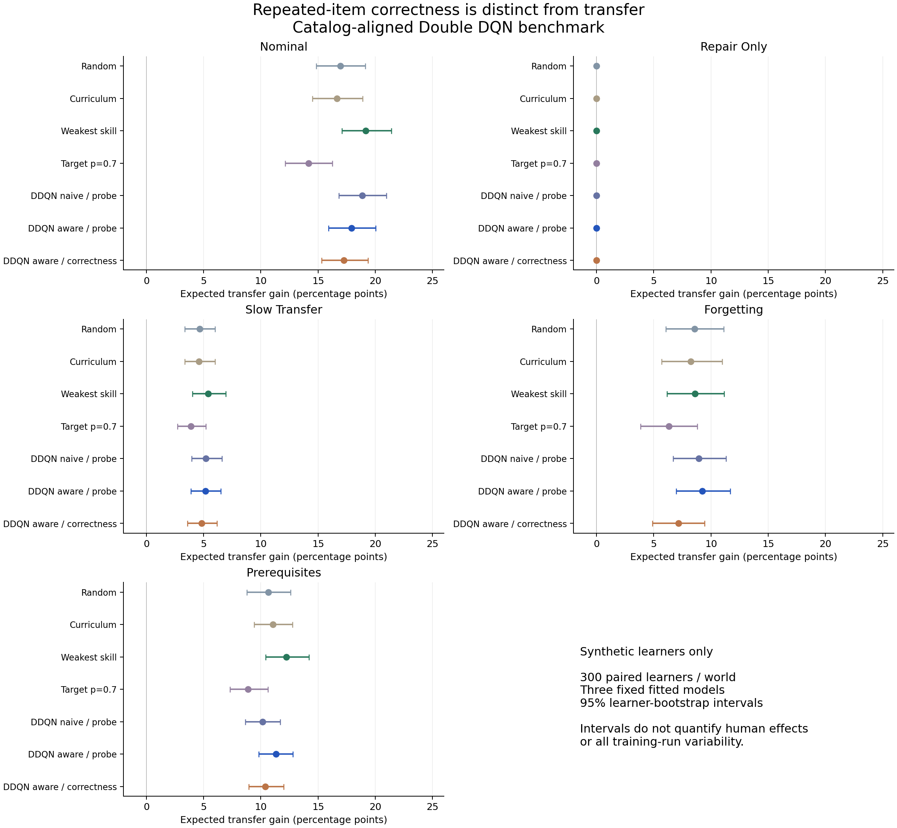

# Kết quả đề 4 — ngân hàng bài và policy v2

**Phạm vi: người học mô phỏng, không phải tiến bộ của sinh viên thật.**

Run `catalog-policy-v2` hoàn tất ngày 26/09/2026; 216.000 transition huấn luyện, 31.500 rollout kiểm tra trên 1.500 định danh người học mô phỏng ghép cặp.

## Kết luận chính

Filter xét độ quen bài giảm NLL ở cả ba tập validation. Tuy nhiên, trong môi trường nominal, policy tương ứng có tiến bộ kỳ vọng thấp hơn DDQN naive 0,93 điểm phần trăm và thấp hơn quy tắc kỹ năng yếu nhất 1,24 điểm phần trăm. Vì vậy **không kết luận policy mới tốt hơn baseline**.

Môi trường prerequisite cho kết quả khác với nominal, cho thấy thứ hạng phụ thuộc cơ chế mô phỏng. Trong repair-only, tất cả policy có gain bằng 0 theo đúng định nghĩa môi trường, dù tỷ lệ đúng khi luyện vẫn cao. Đây là kiểm tra cơ chế/null control, không phải phát hiện thực nghiệm về người thật.

## Dự báo trước kết quả trên validation mô phỏng

| Seed | NLL naive | NLL xét độ quen bài |
|---|---:|---:|
| 101 | 0.637583 | 0.622301 |
| 203 | 0.643206 | 0.631533 |
| 307 | 0.653636 | 0.621808 |

## Tiến bộ trên bài thăm dò chưa luyện

Đơn vị gain và CI: điểm phần trăm của expected probe success cuối trừ đầu. Tỷ lệ đúng khi luyện là một đại lượng khác.

| Môi trường | Policy | Gain | CI 95% | Đúng khi luyện |
|---|---|---:|---|---:|
| nominal | Random | 16.96 | [14.86; 19.13] | 51.69% |
| nominal | Curriculum | 16.64 | [14.50; 18.90] | 54.75% |
| nominal | Weakest skill | 19.16 | [17.07; 21.40] | 50.76% |
| nominal | Target p=0.7 | 14.16 | [12.13; 16.24] | 59.72% |
| nominal | DDQN naive / probe | 18.85 | [16.83; 20.97] | 54.29% |
| nominal | DDQN aware / probe | 17.91 | [15.90; 20.03] | 53.61% |
| nominal | DDQN aware / correctness | 17.24 | [15.30; 19.37] | 56.16% |
| repair_only | Random | 0.00 | [0.00; 0.00] | 43.75% |
| repair_only | Curriculum | 0.00 | [0.00; 0.00] | 47.69% |
| repair_only | Weakest skill | 0.00 | [0.00; 0.00] | 46.10% |
| repair_only | Target p=0.7 | 0.00 | [0.00; 0.00] | 54.86% |
| repair_only | DDQN naive / probe | 0.00 | [0.00; 0.00] | 49.16% |
| repair_only | DDQN aware / probe | 0.00 | [0.00; 0.00] | 48.68% |
| repair_only | DDQN aware / correctness | 0.00 | [0.00; 0.00] | 50.19% |
| slow_transfer | Random | 4.67 | [3.34; 5.99] | 43.50% |
| slow_transfer | Curriculum | 4.59 | [3.34; 5.99] | 46.36% |
| slow_transfer | Weakest skill | 5.39 | [4.03; 6.94] | 42.97% |
| slow_transfer | Target p=0.7 | 3.89 | [2.72; 5.21] | 53.33% |
| slow_transfer | DDQN naive / probe | 5.19 | [3.97; 6.59] | 46.43% |
| slow_transfer | DDQN aware / probe | 5.16 | [3.89; 6.51] | 46.26% |
| slow_transfer | DDQN aware / correctness | 4.82 | [3.60; 6.16] | 49.17% |
| forgetting | Random | 8.56 | [6.07; 11.12] | 48.64% |
| forgetting | Curriculum | 8.24 | [5.68; 10.97] | 50.33% |
| forgetting | Weakest skill | 8.61 | [6.14; 11.16] | 48.38% |
| forgetting | Target p=0.7 | 6.33 | [3.85; 8.79] | 56.71% |
| forgetting | DDQN naive / probe | 8.94 | [6.70; 11.30] | 50.56% |
| forgetting | DDQN aware / probe | 9.26 | [6.96; 11.68] | 50.21% |
| forgetting | DDQN aware / correctness | 7.16 | [4.87; 9.44] | 51.92% |
| prerequisites | Random | 10.66 | [8.79; 12.60] | 46.58% |
| prerequisites | Curriculum | 11.04 | [9.41; 12.76] | 50.25% |
| prerequisites | Weakest skill | 12.21 | [10.41; 14.21] | 47.44% |
| prerequisites | Target p=0.7 | 8.89 | [7.30; 10.62] | 55.29% |
| prerequisites | DDQN naive / probe | 10.14 | [8.66; 11.69] | 48.70% |
| prerequisites | DDQN aware / probe | 11.33 | [9.83; 12.81] | 49.66% |
| prerequisites | DDQN aware / correctness | 10.40 | [8.93; 12.00] | 51.30% |

## Chênh lệch ghép cặp

| Môi trường | Aware/probe trừ | Gain chênh lệch | CI 95% |
|---|---|---:|---|
| nominal | DDQN naive / probe | -0.93 | [-1.87; -0.05] |
| nominal | Weakest skill | -1.24 | [-2.27; -0.21] |
| nominal | DDQN aware / correctness | 0.67 | [-0.31; 1.57] |
| repair_only | DDQN naive / probe | 0.00 | [0.00; 0.00] |
| repair_only | Weakest skill | 0.00 | [0.00; 0.00] |
| repair_only | DDQN aware / correctness | 0.00 | [0.00; 0.00] |
| slow_transfer | DDQN naive / probe | -0.03 | [-0.49; 0.44] |
| slow_transfer | Weakest skill | -0.23 | [-0.78; 0.34] |
| slow_transfer | DDQN aware / correctness | 0.34 | [-0.14; 0.83] |
| forgetting | DDQN naive / probe | 0.31 | [-0.65; 1.27] |
| forgetting | Weakest skill | 0.65 | [-0.49; 1.76] |
| forgetting | DDQN aware / correctness | 2.10 | [1.18; 3.00] |
| prerequisites | DDQN naive / probe | 1.19 | [0.16; 2.20] |
| prerequisites | Weakest skill | -0.88 | [-2.28; 0.47] |
| prerequisites | DDQN aware / correctness | 0.93 | [-0.03; 1.92] |

## Cách đọc và giới hạn

- 1.500 bootstrap replicate lấy mẫu lại learner sau khi trung bình ba fit, cùng learner giữa policy. CI có điều kiện trên ba fit; xem `per_fit` trong JSON để đánh giá biến thiên fit. Không hiệu chỉnh nhiều so sánh.
- Không chọn lại checkpoint theo những số này. App dùng aware/probe seed 101 vì đã ấn định trước kiểm tra, phục vụ demo cơ chế. Nó không phải hệ khuyến nghị được xác nhận là tốt nhất.
- Không khẳng định mô hình đã hội tụ tối ưu. 24.000 transition mỗi mạng là ngân sách cố định; không có learning-curve/budget sweep để chứng minh đủ huấn luyện.
- Kỹ năng/độ khó/dynamics là giả định tác giả. Mô phỏng sinh nhãn binary, không chạy mã; nội dung bài dùng cho tính tương thích phần mềm và demo.
- Kết quả ACcoding thật được giữ riêng: cập nhật lịch sử giảm NLL nhỏ; không đo việc gán bài khác hoặc tác động học tập.
- Muốn công bố kết luận mạnh cần benchmark ngoài simulator này và đối chứng recommendation hiện đại chạy thật. Tài liệu SOTA không thay thế phép so sánh.

Nguồn số liệu: `research/runs/catalog-policy-v2/summary.json`, `rollouts.npz`, `protocol.json`, `record.json`. Bản JSON aggregate trong app được kiểm tra checksum khi triển khai.
